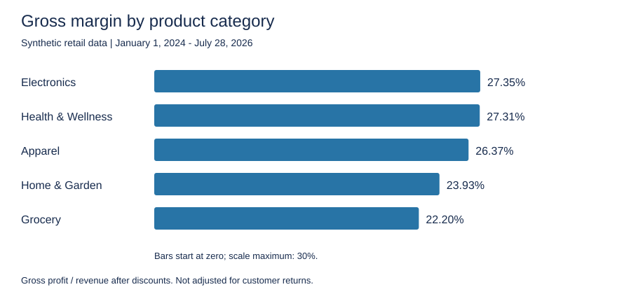

# Retail Sales & Profitability Analysis | SQL

A SQLite case study using synthetic retail data to investigate sales, profitability, returns, and regional revenue targets.

[Source data](data/) | [SQL scripts](sql/) | [Model definitions](sql/01_database_schema.md) | [Verified results](results/)

> Synthetic portfolio data only. No real employer, company, customer, or transaction data is included. Findings do not represent real business impact.

## Business problem

Which products, categories, channels, and regions deserve closer attention when reviewing retail sales and profitability?

## Results at a glance

| Metric | Verified result |
|---|---:|
| Revenue after discounts | $25,912,424.37 |
| Gross profit | $6,607,883.84 |
| Gross margin | 25.50% |
| Distinct orders | 14,671 |
| Order lines | 44,290 |
| Average order value | $1,766.23 |

Revenue and gross profit are not adjusted for customer returns; returns are analyzed separately. Gross profit is not net profit.

[Executive KPI output](results/executive_kpis.csv) | [Executive KPI query](sql/04_executive_kpi_summary.sql)

## Category profitability

Apparel leads category revenue at $7.55M. Electronics has the highest gross margin at 27.35%, narrowly ahead of Health & Wellness at 27.31%; Grocery has the lowest at 22.20%. The 0.04 percentage-point gap between the top two should not be overstated.

Proposed follow-up: examine pricing, discounts, supplier costs, and product mix rather than judging categories by revenue alone.

[Category output](results/category_profitability.csv) | [Category query](sql/06_category_profitability_analysis.sql)

## Other findings

- Tools Item 2 generated approximately $761.0K in revenue, with a 7.06% unit return rate and 14.49% gross margin. Investigate potential quality or fulfillment issues; these results do not establish a cause. The product-risk query includes products with at least $150,000 in revenue, sorted by return rate and revenue, both descending.
- All five regions exceeded their revenue targets in March 2026. Regional reporting includes only month-region combinations with sales and a matching target; unmatched combinations are not separately reported.

[Product-risk query](sql/10_product_return_risk_analysis.sql) | [Regional query](sql/09_regional_revenue_target_attainment.sql)

## Data coverage and model

Order dates run from January 1, 2024 through July 28, 2026. July 2026 is incomplete; do not compare it directly with complete months or interpret it as full-month target attainment.

| Source table | Expected rows |
|---|---:|
| customers | 600 |
| date_reference | 1,096 |
| orders | 44,290 |
| products | 160 |
| returns | 2,657 |
| sales_targets | 155 |
| stores | 38 |

One row in `orders` is one product line within an order, identified by `OrderID` and `OrderLineID` together. Orders reference customers, products, stores, and calendar dates. Returns reference order lines using both identifiers. Regional targets are compared with monthly regional sales totals, not individual order lines.

## Calculation choices

- Revenue after discounts = quantity x selling price x (1 - discount percentage).
- COGS = quantity x product unit cost; historical cost changes are not modeled.
- Gross profit = revenue after discounts - COGS.
- Overall gross margin = total gross profit / total revenue, not an average of row-level margins.
- Unit return rate = returned units / units sold.
- The enriched view uses left joins and labels unmatched stores as `Unassigned Store`.
- The executive query uses `NULLIF` to protect margin and average-order-value divisions from zero denominators.

## Validation and verification scope

The uploaded CSVs were loaded into a fresh in-memory SQLite database. Reproduced SQL logic confirmed the headline KPIs and category results. This was not a verbatim execution of every repository script or a test of DB Browser's manual import workflow.

- No unmatched customer or product references were found.
- 485 order lines have missing `StoreID` values and no matching store record. They remain in company-wide KPIs but are excluded from regional reporting.
- No duplicate keys were found for the checked order-line, customer, product, store, return, calendar-date, or month-region target keys.
- No returns lacked a matching order line.

The existing validation scripts check row counts and customer/product/store matches. Duplicate-key and return-match checks were additional checks in the verification analysis, not new functionality added to those scripts. These are targeted checks, not a complete data-quality test suite.

[Validation output](results/validation_results.csv)

## How to run

1. Download the repository and create a SQLite database in DB Browser for SQLite.
2. Import the seven CSVs from `data/`, using their first row as headers and each filename without `.csv` as the table name.
3. Preserve column names, identifiers, and date strings. Check numeric types for quantities, prices, costs, discounts, and targets; save the imports.
4. Run `01_row_count_audit.sql` and compare with the table above. It reports counts rather than asserting correctness.
5. Run `02_key_integrity_check.sql`; expect zero customer/product issues and 485 store issues.
6. Run `03_create_orders_enriched_view.sql`, which drops and recreates the shared view.
7. Run scripts `04` through `10` individually. Compare KPI and category outputs with `results/` at the precision returned by the queries.

## Tools and limitations

SQLite, DB Browser for SQLite, joins, CTEs, aggregations, window functions, and reusable views support the analysis. The chart is a static SVG generated from the verified category output, not an interactive dashboard.

Results are descriptive. Proposed actions have not been implemented or evaluated for business impact. The schema Markdown file documents relationships and definitions; it is not an executable table-creation script.
